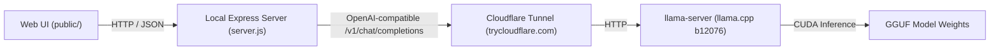
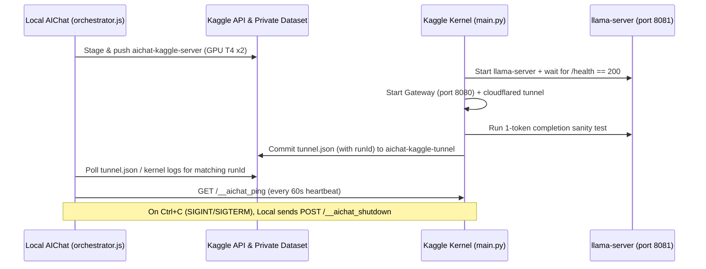

# System Architecture

AIChat (`ai-chat-local` v1.7.1) uses a **local-first client + remote `llama.cpp` inference** architecture with zero intermediate proxy layers like Ollama or LiteLLM in the active path.

---

## 1. Active Request Flow



- **Local Web UI (`public/`):** Vanilla HTML/CSS/JS (`index.html`, `settings.html`, `donate.html`, `app.js`, `settings.js`, `theme.js`) with 12 UI languages in `public/Lang/*.json`.
- **Local Backend (`server.js`):** Serves the UI, manages local JSON persistence under `data/`, performs `{{user}}` macro replacement, builds character/group prompts, extracts memories, and forwards sampling parameters 1:1 to `llama-server`.
- **Remote Inference (`llama-server`):** Runs inside Colab or Kaggle, exposed via a temporary `trycloudflare.com` URL.

---

## 2. Headless `beta-kaggle` Orchestrator Architecture

When started with `npm run beta-kaggle` (`node server.js --beta-kaggle`), `kaggle-kernel/orchestrator.js` automates the entire Kaggle lifecycle:



Key components in `kaggle-kernel/kernel/main.py`:
- **Gateway (`GATEWAY_PORT = 8080` → `LLAMA_INTERNAL_PORT = 8081`):** Multiplexes LLM traffic and lifecycle admin endpoints over a single Cloudflare Tunnel URL.
- **Heartbeat & Remote Shutdown:** `GET /__aichat_ping` resets the idle timer; `POST /__aichat_shutdown` terminates `llama-server` and `cloudflared` immediately on `Ctrl + C`.
- **Auto-Idle Watchdog (`IDLE_TIMEOUT_SECONDS = 1800`):** Shuts down the Kaggle kernel after 30 minutes of no heartbeat or chat activity (paused while streaming is in-flight).

---

## 3. Local Filesystem Storage (`data/`)

All user data is stored locally as atomic-written JSON files (`writeJSON` via temp file + `fs.renameSync`) with strict UUID allowlist validation (`ID_RE = /^[A-Za-z0-9_-]{1,200}$/`) to prevent path traversal:

```text
data/
├── characters/
│   └── <characterId>.json
├── chats/
│   ├── private/
│   │   └── <characterId>/
│   │       └── <chatId>.json        # Scoped per-character (v1.7.1+)
│   └── groups/
│       └── <groupId>/
│           └── <chatId>.json        # Multi-session group chats (v1.6.0+)
├── memory/
│   ├── private/
│   │   └── <characterId>.json       # Facts, events, summary, active personaId
│   └── groups/
│       └── <groupId>.json           # Shared group memory
└── persona/
    └── <personaId>.json             # User persona profiles
```
