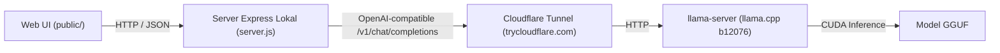
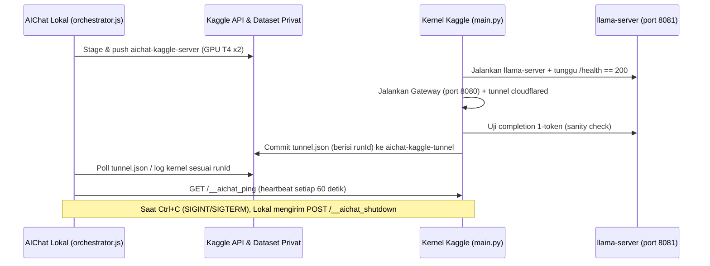

# Arsitektur Sistem

AIChat (`ai-chat-local` v1.7.1) menggunakan arsitektur **klien lokal (*local-first*) + inferensi `llama.cpp` remote** tanpa lapisan proxy tambahan seperti Ollama atau LiteLLM pada jalur aktifnya.

---

## 1. Alur Request Aktif



- **Web UI Lokal (`public/`):** HTML/CSS/JS murni (`index.html`, `settings.html`, `donate.html`, `app.js`, `settings.js`, `theme.js`) dengan dukungan 12 bahasa antarmuka di `public/Lang/*.json`.
- **Backend Lokal (`server.js`):** Menyajikan UI, mengelola penyimpanan JSON lokal di `data/`, mengganti makro `{{user}}`, menyusun prompt karakter/grup, mengekstrak memori, dan meneruskan parameter sampling secara 1:1 ke `llama-server`.
- **Inferensi Remote (`llama-server`):** Berjalan di Colab atau Kaggle, lalu diekspos melalui URL `trycloudflare.com`.

---

## 2. Arsitektur Orchestrator Headless `beta-kaggle`

Saat dijalankan dengan `npm run beta-kaggle` (`node server.js --beta-kaggle`), `kaggle-kernel/orchestrator.js` mengotomatiskan seluruh siklus hidup Kaggle:



Komponen utama di `kaggle-kernel/kernel/main.py`:
- **Gateway (`GATEWAY_PORT = 8080` → `LLAMA_INTERNAL_PORT = 8081`):** Menggabungkan trafik LLM dan endpoint manajemen dalam satu URL Cloudflare Tunnel.
- **Heartbeat & Remote Shutdown:** `GET /__aichat_ping` mereset timer idle; `POST /__aichat_shutdown` langsung menghentikan `llama-server` dan `cloudflared` saat `Ctrl + C` ditekan.
- **Auto-Idle Watchdog (`IDLE_TIMEOUT_SECONDS = 1800`):** Mematikan kernel Kaggle secara otomatis setelah 30 menit tanpa heartbeat atau aktivitas chat (dijeda saat streaming sedang berlangsung).

---

## 3. Struktur Penyimpanan Lokal (`data/`)

Seluruh data pengguna disimpan secara lokal sebagai file JSON dengan penulisan atomik (`writeJSON` via file sementara + `fs.renameSync`) dan validasi allowlist UUID (`ID_RE = /^[A-Za-z0-9_-]{1,200}$/`) untuk mencegah *path traversal*:

```text
data/
├── characters/
│   └── <characterId>.json
├── chats/
│   ├── private/
│   │   └── <characterId>/
│   │       └── <chatId>.json        # Terkelompok per karakter (v1.7.1+)
│   └── groups/
│       └── <groupId>/
│           └── <chatId>.json        # Group chat multi-sesi (v1.6.0+)
├── memory/
│   ├── private/
│   │   └── <characterId>.json       # Fakta, event, ringkasan, personaId aktif
│   └── groups/
│       └── <groupId>.json           # Memori grup bersama
└── persona/
    └── <personaId>.json             # Profil persona pengguna
```
